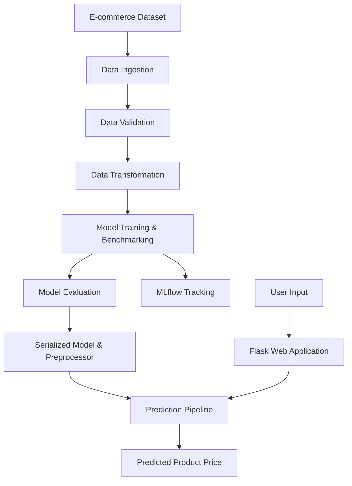

# OptiPrice — End-to-End Dynamic Pricing Engine

An end-to-end Machine Learning application that predicts product prices using e-commerce data and pricing-related features. Built with **Python, CatBoost, Flask, Docker, and MLflow**, OptiPrice combines model experimentation, modular ML pipelines, and web-based inference in a single project.

<p align="center">
  
  
  
  
  
  
</p>

**Live Demo:** [OptiPrice Web Application](https://optiprice-engine.onrender.com)

**Repository:** [GitHub — Samir-Shaw/optiprice](https://github.com/Samir-Shaw/optiprice)

---

## Table of Contents

- [Overview](#overview)
- [Key Features](#key-features)
- [Model Performance](#model-performance)
- [Technology Stack](#technology-stack)
- [System Architecture](#system-architecture)
- [Project Structure](#project-structure)
- [Getting Started](#getting-started)
- [Running with Docker](#running-with-docker)
- [Experiment Tracking with MLflow](#experiment-tracking-with-mlflow)
- [How It Works](#how-it-works)
- [Future Improvements](#future-improvements)
- [Author](#author)

## Overview

OptiPrice is a machine learning project focused on predicting product prices from e-commerce transaction data and relevant pricing features.

The project follows a modular, end-to-end ML workflow, covering data ingestion, validation, preprocessing, model training, experiment tracking, and deployment through a Flask web application.

The application accepts product-related inputs, processes them through the trained ML pipeline, and returns a price prediction through an interactive web interface.

The project is designed to demonstrate practical machine learning engineering concepts, including reproducible experiments, reusable preprocessing components, model serialization, containerization, and automated CI checks.

## Key Features

- **End-to-End ML Pipeline:** Modular components for data ingestion, validation, transformation, and model training.
- **Exploratory Data Analysis:** Dedicated notebooks for understanding the dataset, identifying patterns, and comparing models.
- **CatBoost Regression:** Uses CatBoost Regressor for tabular data modelling.
- **Model Benchmarking:** Compares multiple algorithms using regression evaluation metrics.
- **MLflow Integration:** Tracks model parameters, evaluation metrics, and experiment runs.
- **Reusable Preprocessing:** Saves the fitted preprocessing pipeline for consistent inference.
- **Flask Web Interface:** Provides a form-based interface for submitting inputs and viewing predictions.
- **Model Serialization:** Stores trained model artifacts for reuse without retraining on every request.
- **Docker Support:** Packages the application and its dependencies into a container.
- **GitHub Actions CI:** Automates configured code-quality checks and smoke tests.

## Model Performance

The following results are reported from experiments on **12,000 synthetic e-commerce transaction records**.

| Metric | Reported Result |
|---|---:|
| R² Score | 0.9987 |
| RMSE | $6.28 |
| MAE | $3.84 |
| Inference Latency | Under 45 ms |

### What These Metrics Mean

- **R² Score:** Measures how much of the variation in the target values is explained by the model.
- **RMSE:** Measures prediction error while penalizing larger errors more heavily.
- **MAE:** Measures the average absolute difference between actual and predicted prices.
- **Inference Latency:** Measures the time required to generate a prediction under the tested conditions.

> **Note:** These are reported experimental results, not independently verified production benchmarks. Since the dataset is synthetic, the high R² score should be validated against leakage, the train-test split, and more realistic unseen data before making claims about real-world pricing performance.

## Technology Stack

| Category | Technologies |
|---|---|
| Programming Language | Python 3.10 |
| Data Processing | Pandas, NumPy |
| Machine Learning | Scikit-learn, CatBoost |
| Model Evaluation | R², RMSE, MAE |
| Experiment Tracking | MLflow |
| Web Framework | Flask, Jinja2 |
| Frontend | HTML, CSS |
| Serialization | Pickle-based model artifacts |
| Containerization | Docker |
| CI/CD | GitHub Actions |
| Development | Jupyter Notebook, Git, GitHub |

## System Architecture



### Pipeline Components

1. **Data Ingestion:** Loads the source dataset and creates training and testing datasets.
2. **Data Validation:** Checks the expected schema and validates input data.
3. **Data Transformation:** Applies the configured preprocessing steps using a reusable transformer.
4. **Model Training:** Trains and evaluates regression algorithms, including CatBoost.
5. **Experiment Tracking:** Records training parameters and metrics in MLflow.
6. **Prediction Pipeline:** Loads the saved artifacts and transforms incoming inputs consistently.
7. **Web Application:** Accepts user inputs through Flask and displays the predicted price.

## Project Structure

```text
optiprice/
├── .github/
│   └── workflows/
│       └── main.yaml
├── artifacts/
│   ├── model.pkl
│   └── preprocessor.pkl
├── data/
│   └── ecommerce_pricing.csv
├── notebooks/
│   ├── 01_eda.ipynb
│   └── 02_model_experiment.ipynb
├── src/
│   ├── components/
│   │   ├── data_ingestion.py
│   │   ├── data_validation.py
│   │   ├── data_transformation.py
│   │   └── model_trainer.py
│   ├── pipeline/
│   │   ├── train_pipeline.py
│   │   └── predict_pipeline.py
│   ├── exception.py
│   ├── logger.py
│   └── utils.py
├── static/
│   └── css/
│       └── style.css
├── templates/
│   └── home.html
├── app.py
├── Dockerfile
├── .dockerignore
├── requirements.txt
├── setup.py
└── README.md
```

## Getting Started

### Prerequisites

Make sure the following are installed:

- Python 3.10
- Git
- pip
- Conda (optional)
- Docker (optional)

### 1. Clone the Repository

```bash
git clone https://github.com/Samir-Shaw/optiprice.git
cd optiprice
```

### 2. Create and Activate a Virtual Environment

**Using Conda:**

```bash
conda create -n optiprice_env python=3.10 -y
conda activate optiprice_env
```

**Alternatively, using Python's built-in venv:**

```bash
python -m venv venv
```

Windows:

```bash
venv\Scripts\activate
```

Linux/macOS:

```bash
source venv/bin/activate
```

### 3. Install Dependencies

```bash
python -m pip install --upgrade pip
pip install -r requirements.txt
pip install -e .
```

### 4. Train the Model

Run the end-to-end training pipeline:

```bash
python src/pipeline/train_pipeline.py
```

This step should execute the configured ingestion, validation, transformation, and training components and generate the model artifacts.

### 5. Start the Flask Application

```bash
python app.py
```

Open the application in your browser:

[http://127.0.0.1:5000](http://127.0.0.1:5000)

**Important:** Ensure that the source dataset is available at the expected path and that the training pipeline generates the artifacts required by the prediction pipeline before launching the application.

## Running with Docker

Build the Docker image:

```bash
docker build -t optiprice:latest .
```

Run the container:

```bash
docker run --rm -p 5000:5000 optiprice:latest
```

Open [http://127.0.0.1:5000](http://127.0.0.1:5000).

Ensure the Docker configuration includes the necessary model artifacts or the appropriate training/build steps.

## Experiment Tracking with MLflow

OptiPrice integrates MLflow to track model experiments and evaluation metrics.

Start the MLflow UI:

```bash
mlflow ui --port 5001
```

Open:

[http://127.0.0.1:5001](http://127.0.0.1:5001)

Depending on the configured MLflow tracking URI, make sure the UI points to the same tracking store used during training.

You can use MLflow to compare experiment runs, inspect logged parameters and metrics, and review available model artifacts.

## How It Works

1. The training pipeline loads the e-commerce dataset.
2. The data validation component checks the expected input structure.
3. The transformation component prepares the features for model training.
4. Regression models are trained and evaluated on the configured dataset split.
5. The selected model and preprocessing object are serialized.
6. The Flask application accepts product-related inputs.
7. The prediction pipeline applies the saved preprocessing steps and generates a price estimate.
8. The result is displayed in the web interface.

## Future Improvements

- **Real-World Data Validation:** Evaluate performance on genuine historical transactions and unseen products.
- **Pricing Optimization:** Add an explicit optimization objective based on profit, demand, inventory, and business constraints.
- **Demand Forecasting:** Incorporate time-series features and demand forecasts into pricing decisions.
- **Model Monitoring:** Track prediction drift, data drift, latency, and model performance over time.
- **Automated Retraining:** Introduce scheduled or trigger-based model retraining.
- **Cloud Deployment:** Deploy the application with a reproducible cloud-based serving workflow.
- **API Testing:** Add automated tests for prediction endpoints, input validation, and failure scenarios.

## Author

**Samir Shaw**

B.Tech in Computer Science and Engineering

- GitHub: [Samir-Shaw](https://github.com/Samir-Shaw)
- LinkedIn: [samirshaw](https://www.linkedin.com/in/samirshaw/)
- Portfolio: [samirshaw.me](https://samirshaw.me)

---

If you find this project useful, consider giving the repository a ⭐ on GitHub.
